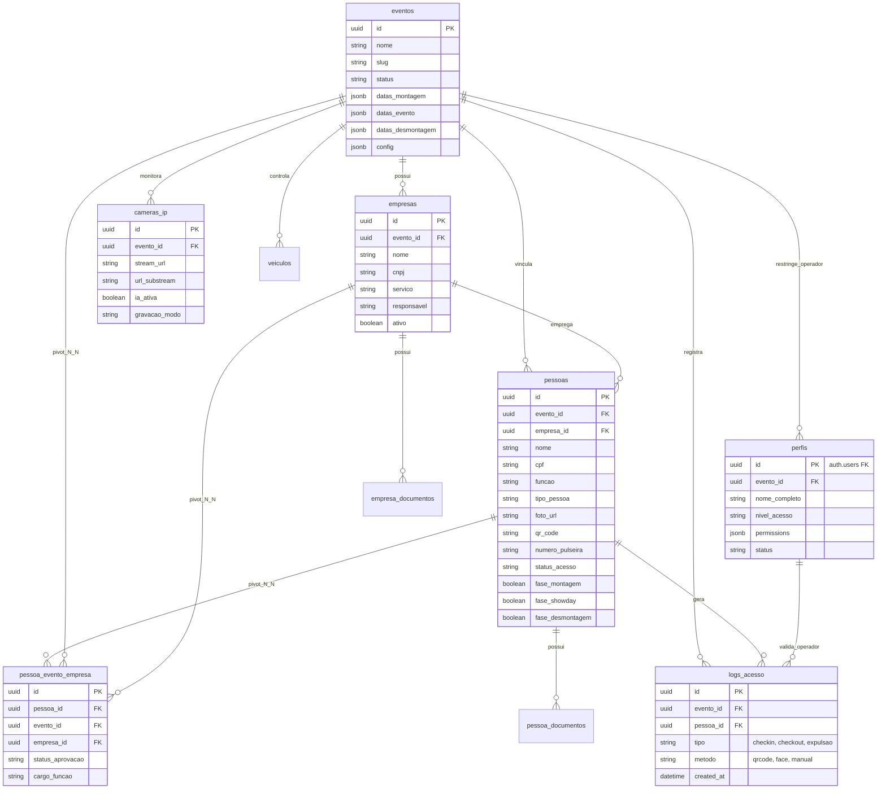

# Diagnóstico do Sistema Atual — NZT Intelligent Control System
**Módulo de Produção de Eventos**  
**Data:** 19/11/2026 | **Versão:** 1.0 | **Status:** Concluído (Fase 1)

---

## 1. Stack Tecnológico Atual

| Camada | Tecnologia / Versão | Detalhes no Repositório |
|---|---|---|
| **Frontend Principal** | React 18.2.0 + Vite 5.0.0 | `frontend/web-admin`: Material UI (MUI 5.18.0), Emotion, `@mui/x-data-grid`, `notistack`, `date-fns`, `html5-qrcode`, `react-webcam`, `react-rnd`, `socket.io-client`, `i18next`. Tema Cyberpunk Dark Industrial (`#050B18`, `#0A1628`, `#00D4FF`, `#7B2FBE`), padronizado via tokens (`styles/tokens.js`, `styles/theme.js`) e guia `docs/PADRAO_INTERFACE.md`. |
| **Frontend Público** | Next.js 14+ | `frontend/public-web`: Portal de auto-credenciamento e envio de documentação para participantes e empresas parceiras. |
| **Frontend Mobile** | React Native / Expo | `frontend/mobile-app`: App móvel legado/suporte. |
| **Backend Principal** | Node.js 20+ / Express 4.22.1 | `backend/api-nodejs`: Monólito modular REST com Express, `@supabase/supabase-js` (v2.95.3), driver nativo `pg` (v8.20.0), `helmet`, `compression`, `cors`, `winston` (logs diários rotativos), `@sentry/node` (v10.71.0 com profiling/tracing). |
| **Banco de Dados Principal** | Supabase (PostgreSQL 15+) | Hospedado na nuvem Supabase com extensões (`uuid-ossp`, `pgcrypto`). Row Level Security (RLS) habilitado nas tabelas públicas. Migrations organizadas em `supabase/migrations/`. |
| **Banco / Legado Sync** | SQL Server (MSSQL 9.3) | `backend/api-nodejs/src/config/database.js`: Driver `tedious`/`mssql` para sincronização com banco legado A2Eventos (opcional via `.env`). |
| **Autenticação & Sessão** | Supabase Auth (JWT) + RBAC | JWT assinado pelo Supabase, decodificação local em memória com verificação de assinatura (`SUPABASE_JWT_SECRET`), fallback para `supabase.auth.getUser()`, cache de token de 60s em memória (`authCache.js`), tabela `perfis` com JSON de permissões (`permissions`) e vínculo de eventos (`vinculo_tipo`, `eventos_permitidos`, `eventos_permissoes`). |
| **Armazenamento de Arquivos** | Supabase Storage + Google Drive | `storageSeguro.js` intermediando Supabase Storage (buckets: `selfies`, `avatars`, `fotos-perfil`, `documentos`, `documentos_operacionais`) com proteção rigorosa contra *Path Traversal*, URLs assinadas temporárias (600s). `googleDrive.service.js` para arquivamento de alertas e gravações de vídeo. |
| **Filas & Processamento Assíncrono**| Redis Streams + Fallback em memória | `backend/api-nodejs/src/services/queue.service.js`: Redis Streams (`stream:access_logs_up`, `stream:sync_entities_down`) com grupo consumidor `cloud_sync_group` e reconexão infinita. Operação em memória quando Redis indisponível. Agendamento com `node-cron`. |
| **Tempo Real (Realtime)** | Socket.IO 4.8.3 | `backend/api-nodejs/src/services/websocketService.js` com `@socket.io/redis-adapter` para escalabilidade horizontal. Comunicações com agentes locais de hardware, alertas de CFTV/câmeras e atualizações no dashboard. |
| **Motor de Visão Computacional** | Python 3.10+ / FastAPI / DirectML / CUDA | `backend/microservice-face-python`: FastAPI em `127.0.0.1:8000`, modelos SCRFD (detecção) e ArcFace (embeddings 512-D), indexação vetorial FAISS, DirectML (AMD/Intel/NVIDIA) e CUDA. |
| **Agente Local de Borda (CFTV)** | Node.js + go2rtc + FFmpeg | `backend/agent-local`: Gateway local nos eventos para captura RTSP/WebRTC de câmeras IP (Intelbras, Hikvision, Tapo, Mercusys), gravação contínua em MP4 local e comunicação bidirecional via WebSocket com a VPS. |
| **Geração de Documentos** | PDFKit 0.20.2 + ExcelJS 4.4.0 | `backend/api-nodejs/src/services/pdf.service.js`: Geração síncrona de relatórios de credenciamento (A4 retrato) e diário consolidado (A4 paisagem) com bufferPages. |
| **PWA & Cache Offline** | Vite Plugin PWA + Workbox + Dexie | `vite-plugin-pwa` configurado em `web-admin` gerando `sw-v2.js`, Web App Manifest completo, cache de assets e runtime cache. Banco local no navegador via Dexie (IndexedDB) para check-in offline (`LocalCheckinService.js`). |
| **Hospedagem & Infraestrutura** | VPS Linux (Hostinger) + Nginx + Docker | Nginx reverse proxy gerenciando terminação SSL (Let's Encrypt), CORS e proxy reverso para `api-nodejs` (porta 3001) e `web-admin` (estáticos). |

---

## 2. Mapa de Módulos Existentes e Conexões

```mermaid
graph TD
    subgraph Frontend["Frontend (Vite / React - web-admin)"]
        UI_Dash["Dashboard Geral (/dashboard)"]
        UI_Checkin["Check-in & Checkout (/checkin, /checkout)"]
        UI_Auditoria["Auditoria Documental (/auditoria)"]
        UI_Cadastros["Empresas & Participantes (/empresas, /pessoas)"]
        UI_Cftv["CFTV Wall & Monitor (/cftv, /monitor)"]
        UI_Fiscalizacao["Fiscalização de Áreas (/fiscalizacao)"]
        UI_Config["Configurações & Equipamentos (/config/*)"]
        UI_PWA["Service Worker PWA (sw-v2.js) + Dexie Offline"]
    end

    subgraph Backend["Backend API (Express Node.js)"]
        AuthMod["Módulo Auth & RBAC (auth.routes / auth.js)"]
        EventMod["Módulo Eventos & Config (event.routes)"]
        EntityMod["Módulo Entidades (Pessoas, Empresas, Veículos)"]
        AccessMod["Módulo Acesso & Catracas (checkin.routes)"]
        DocMod["Módulo Documentos (documento.routes)"]
        ReportMod["Módulo Relatórios (report.routes & pdf.service)"]
        DeviceMod["Módulo Dispositivos & CFTV (device / camera.routes)"]
        QueueSvc["Queue & Sync Service (Redis / Memory)"]
        WSSvc["WebSocket Service (Socket.IO)"]
    end

    subgraph HardwareEdge["Borda Local do Evento"]
        AgentLocal["Agente Local (agent-local) + go2rtc"]
        PyMotor["Motor IA Facial (microservice-face-python)"]
        Cameras["Câmeras IP RTSP / Leitores Faciais"]
    end

    subgraph DataStorage["Bancos & Armazenamento"]
        SupabaseDB[("PostgreSQL (Supabase)")]
        SupabaseStore["Supabase Storage (Buckets Privados)"]
        RedisCache[("Redis (Fila & Cache)")]
        GDrive["Google Drive (Backup de Gravações)"]
    end

    %% Conexões Frontend -> Backend
    UI_Dash --> AuthMod
    UI_Checkin --> AccessMod
    UI_Auditoria --> DocMod
    UI_Cadastros --> EntityMod
    UI_Cftv --> DeviceMod
    UI_Fiscalizacao --> AccessMod
    UI_Config --> EventMod
    UI_PWA -.-> UI_Checkin

    %% Conexões Backend -> Data
    AuthMod --> SupabaseDB
    EventMod --> SupabaseDB
    EntityMod --> SupabaseDB
    EntityMod --> SupabaseStore
    AccessMod --> SupabaseDB
    AccessMod --> QueueSvc
    DocMod --> SupabaseStore
    DocMod --> SupabaseDB
    ReportMod --> SupabaseDB
    DeviceMod --> SupabaseDB
    QueueSvc --> RedisCache
    WSSvc --> UI_Dash
    WSSvc --> UI_Cftv

    %% Conexões Borda -> Backend
    AgentLocal <--> WSSvc
    AgentLocal <--> PyMotor
    Cameras --> AgentLocal
    AgentLocal --> GDrive
```

---

## 3. Modelo de Dados Atual e Entidades Reaproveitáveis

### Entidades que já servem e atendem ao Módulo de Produção:
1. **`eventos`**: Contém o escopo fundamental (tenant do evento), período de datas (fase de montagem, showday, desmontagem) e parâmetros operacionais.
2. **`empresas`**: Serve perfeitamente como cadastro base de **fornecedores e prestadores de serviço** da produção (cenografia, geradores, iluminação, áudio, segurança, etc.).
3. **`pessoas`**: Cadastros de colaboradores, staff, técnicos e coordenadores com foto biométrica, CPF, telefone, QR Code de credencial e dados pessoais.
4. **`pessoa_evento_empresa`**: Permite vincular uma mesma pessoa a múltiplos eventos e empresas/fornecedores com funções distintas.
5. **`perfis`**: Base de usuários do painel administrativo. O modelo `User` suporta permissões por módulo (`permissions`), vínculo flexível (`vinculo_tipo`) e lista de eventos permitidos (`eventos_permitidos`).
6. **`logs_acesso`**: Base de auditoria de check-in, check-out e expulsão física com data, hora, método e operador responsável.

---

## 4. Autenticação e Permissões (RBAC / RLS)

### Como funciona hoje:
1. **Papéis Atuais (`nivel_acesso`)**:
   - `admin_master` / `master`: Soberania total, multieventos, controle irrestrito.
   - `admin`: Administrador do evento com quase todos os acessos liberados.
   - `supervisor`: Cargo intermediário operacional.
   - `operador`: Acesso restrito apenas aos módulos habilitados explicitamente na coluna JSON `permissions` do seu perfil.
2. **Checagem de Permissões**:
   - **Frontend**: `AuthContext.jsx` (`hasPermission(recurso, acao)` e `hasMenuAccess(menuKey)`), validando as chaves canônicas de módulo e a lista de eventos permitidos.
   - **Backend**: `auth.js` (`authenticate`, `authorize(...roles)`, `checkPermission(recurso, acao)`).
   - **Multi-tenancy por Evento**: Cabeçalho HTTP `x-evento-id` ou query parameter `?evento_id=`, validado no backend via `req.tenantId` e confrontado com `eventos_permitidos`.

### O que falta para os novos perfis da Produção:
O Módulo de Produção exige a especificação de **7 novos papéis/perfis** com granularidade de área e segregação estrita de dados:
- `produtor_geral`: Visão executiva macro do evento, todas as áreas, aprovação de tarefas, visão de cachês e orçamentos.
- `arquiteto_evento`: Focado em plantas e projetos, responsável exclusivo por **aprovar/rejeitar intervenções e publicar versões oficiais de plantas**.
- `financeiro`: Gestão de orçamentos, contratos, cachês, pagamentos e relatórios financeiros (sem intervenção na operação de campo).
- `auditoria`: Catálogo de materiais, contagens por IA, divergências de recebimento, auditoria de presença e cachês (sem edição da operação).
- `produtor_area` (infra, palco, som, luz, A&B, etc.): **Acesso estritamente restrito à sua área de atuação** (`area_id`). Pega tarefas, anexa evidências, propõe alterações em planta. **Vê exclusivamente o próprio cachê** (e nunca o de outros produtores).
- `staff`: Consulta de tarefas pontuais atribuídas e registro de presença pessoal.

> 🔒 **Regra de Segurança Inegociável (Cachê e Valores)**: A restrição de visualização de valores de cachê deve ser aplicada diretamente na camada de serviço e nas consultas SQL/Supabase (filtrando a coluna ou registro antes de devolver ao cliente HTTP), nunca apenas ocultando o campo na interface React.

---

## 5. Estado do PWA (Progressive Web App)

### O que já existe:
- Plugin `vite-plugin-pwa` (v1.2.0) integrado ao `frontend/web-admin/vite.config.js`.
- Arquivo `sw-v2.js` com Workbox configurado: cache de assets, ícones do app, fallbacks limpos para `/api/` e `/socket.io/`.
- Manifest Web completo (`display: standalone`, `theme_color: #050B18`, ícones de 48px a 512px com suporte a maskable).
- Banco local IndexDB via `dexie` (`A2EventosDB`) e sincronização de check-in offline com retentativas e detecção de conectividade (`LocalCheckinService.js`).

### O que falta para campo com internet ruim (Fase 1 do Módulo de Produção):
1. **Fila Offline de Tarefas e Evidências**: O produtor de área precisa poder abrir tarefas, marcar checklists, tirar fotos e gravar áudios em áreas sem sinal de internet (galpões metálicos, subsolos, áreas rurais de festival).
2. **Upload Resumable / Chunked com Compressão**: Fotos capturadas no celular devem ser comprimidas no cliente (via Canvas ou Web Worker antes do envio) para 1-2 MB, e uploads de vídeos de evidência devem ser fatiados em partes para não falharem em conexões instáveis.
3. **PWA Push Notifications (Web Push / VAPID)**: Notificações no celular do produtor avisando sobre tarefas atribuídas, alertas de prazo iminente ou aprovação de intervenção de planta, mesmo com o navegador fechado.
4. **Camada de abstração compatível com Capacitor**: Para futuro empacotamento em app nativo iOS/Android sem retrabalho de código.

---

## 6. Mídia, Geração de PDF e Processamento Assíncrono

### O que já existe:
- **Upload de Mídia**: `multer` configurado na API Express, `sharp` para redimensionamento e otimização de imagens, serviço `storageSeguro.js` enviando para buckets Supabase ou gravando temporariamente em disco.
- **Geração de PDF**: `pdfkit` integrado em `backend/api-nodejs/src/services/pdf.service.js`. Produz relatórios vetoriais elegantes de credenciamento e relatório diário de portaria.
- **Processamento Assíncrono**: `queue.service.js` com Redis Streams para eventos de acesso, `cloud_sync_worker.js` e agendamentos com `node-cron`.
- **Visão Computacional**: Microserviço Python FastAPI (`microservice-face-python`) já operando leitura RTSP, extração de frames, inferência com GPU/DirectML e geração de eventos via HTTP/Socket.

### O que falta para a Produção:
- **PDFs Customizados com Layout Complexo**: Relatórios diários com evidências fotográficas, cabeçalhos dinâmicos, marcas d'água de confidencialidade e plantas vetorizadas.
- **Fila de Renderização de PDF**: Como relatórios com dezenas de fotos de alta resolução consomem CPU, a geração precisa ser assíncrona com notificação de download pronto.
- **Fila de Processamento de Vídeo para Contagem de Materiais**: Serviço dedicado para receber vídeos gravados ou streams e devolver as contagens auditáveis.

---

## 7. Dívidas Técnicas e Riscos Identificados

1. **Geração Síncrona de PDFs no Loop de Eventos do Node**: O `pdf.service.js` atual roda síncrono no processo do Express. Relatórios pesados de produção (com dezenas de fotos) bloquearão o event loop do Node.js se não forem isolados em worker/fila assíncrona.
2. **Licenciamento do YOLO (Risco AGPL-3.0)**: O uso de modelos Ultralytics YOLO (YOLOv8/11/26) para fins comerciais exige licença Enterprise ou licenciamento via parceiro credenciado (Roboflow). É imperativo formalizar um ADR comparando Ultralytics vs alternativas permissivas (RF-DETR, RT-DETR sob licença Apache 2.0).
3. **Escala de Canvas e Intervenções Vetoriais**: Plantas em DWG/CAD precisam ser convertidas em raster de alta fidelidade (PNG/SVG) e renderizadas em canvas com escala real calibrável. Não existe biblioteca de canvas gráfico no frontend hoje.
4. **Isolamento de Cachês e Dados Financeiros**: O sistema atual não possui campos nativos para cachê ou valor de diária nas tabelas de pessoas/usuários. Qualquer vazamento de dados de cachê para outros produtores geraria atrito imediato em eventos ao vivo.
5. **Cobertura de Testes**: Existem testes unitários para o modelo User e serviços críticos, mas faltam testes automatizados de controle de acesso para perfis com permissões granulares por evento e área.

---

## 8. Lacunas: Criar do Zero vs. Estender

| Componente / Recurso | Status | Estratégia Técnica |
|---|---|---|
| **Cadastro de Produtores e Vínculos** | Estender | Aproveitar `pessoas` + `perfis` + `pessoa_evento_empresa`, adicionando tabela `produtores_dados` (dados bancários cifrados, áreas, modelo de cachê) e novas roles. |
| **Página Exclusiva da Produção (`/producao`)** | Criar do zero | Conforme orientação expressa do usuário: criar página separada, com navegação limpa, alinhada aos tokens e ao design system do sistema NZT. |
| **Módulo de Projetos e Arquivos** | Criar do zero | Novas tabelas `producao_projetos` e `producao_arquivos` com versionamento e vínculo por área. |
| **Tarefas, Etapas e Checklist** | Criar do zero | Tabelas `producao_tarefas`, `producao_etapas`, `producao_evidencias` com upload offline e trilha de auditoria. |
| **Editor de Planta Baixa Interativo** | Criar do zero | Integração de biblioteca de Canvas vetorial (Konva / React-Konva) com suporte a camadas, setores e propostas de alteração (ADR 0001). |
| **Fluxo de Proposta e Aprovação de Plantas** | Criar do zero | Versionamento vetorial em JSON (`producao_planta_versoes` e `producao_planta_propostas`) com visualização de diff e conflitos. |
| **Catálogo de Materiais & Contagem IA** | Criar do zero | Catálogo em banco (`producao_materiais`), sessões de conferência e microserviço de contagem por vídeo (ADR 0002). |
| **Presença em Produção & Dobras** | Estender | Reutilizar `logs_acesso` criando camada de regras para detecção de dobras, controle de escalas por área e cálculo de horas. |
| **Relatórios Customizados em PDF** | Estender | Aproveitar `pdf.service.js` ou Playwright headless com fila assíncrona e marca d'água personalizada (ADR 0003). |
| **Sincronização Offline em Campo** | Estender | Expandir o `Dexie` (`A2EventosDB`) e `LocalCheckinService` para gerenciar a fila offline de tarefas e evidências (ADR 0004). |
