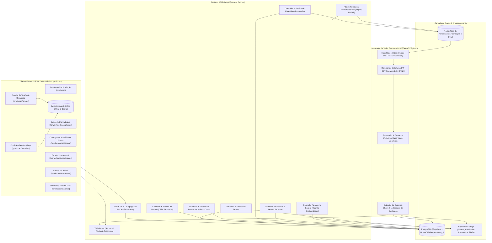
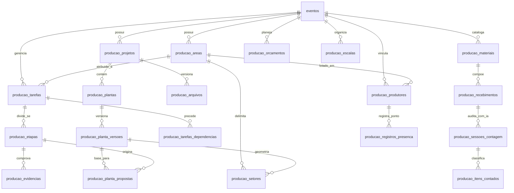
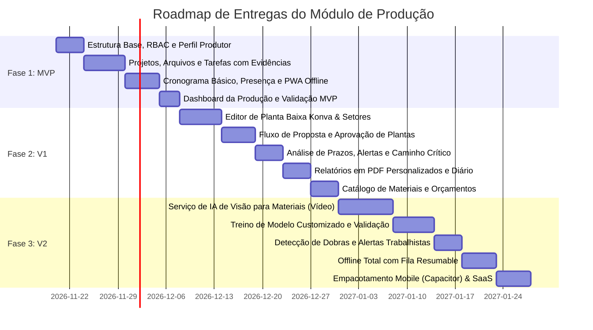

# Plano de Ação — Módulo de Produção de Eventos
**Sistema:** NZT Intelligent Control System  
**Data:** 19/11/2026 | **Versão:** 1.0 | **Documento:** 02-plano-de-acao.md  
**Status:** Aprovado e Implementado (Entrega Inicial — Área `/producao`, Backend, Migração SQL e Testes)

---

## 1. Visão do Módulo em 1 Parágrafo

O **Módulo de Produção** do NZT é a primeira plataforma *All-in-One* concebida para a realidade dos grandes eventos ao vivo no Brasil, unificando em um ambiente web e PWA de alta performance o gerenciamento de cronograma, equipes e custos, a marcação colaborativa de plantas baixas com fluxo formal de aprovação pelo Arquiteto, o checklist de campo com evidências multimídia resiliente a conexões ruins e a conferência automatizada de recebimento de materiais pesados através de visão computacional por vídeo — integrando nativamente a montagem, o credenciamento de portaria e a auditoria em um único fluxo de dados seguro e multi-tenant.

---

## 2. Arquitetura Proposta Integrada ao Sistema Atual



---

## 3. Novo Modelo de Dados (PostgreSQL / Supabase)

O esquema foi projetado com isolamento multi-tenant por `evento_id`, chaves estrangeiras com integridade referencial, índices para consultas rápidas do dashboard e histórico de auditoria.



### 3.1 DDL e Especificação das Novas Tabelas

```sql
-- ==========================================================
-- 1. ÁREAS DE ATUAÇÃO DA PRODUÇÃO
-- ==========================================================
CREATE TABLE IF NOT EXISTS producao_areas (
    id UUID PRIMARY KEY DEFAULT gen_random_uuid(),
    evento_id UUID NOT NULL REFERENCES eventos(id) ON DELETE CASCADE,
    nome VARCHAR(100) NOT NULL, -- Infraestrutura, Palco, Som, Luz, A&B, Limpeza, etc.
    cor VARCHAR(10) DEFAULT '#00D4FF',
    descricao TEXT,
    responsavel_principal_id UUID REFERENCES pessoas(id) ON DELETE SET NULL,
    ativo BOOLEAN DEFAULT true,
    created_at TIMESTAMPTZ DEFAULT NOW(),
    updated_at TIMESTAMPTZ DEFAULT NOW()
);
CREATE INDEX idx_producao_areas_evento ON producao_areas(evento_id);

-- ==========================================================
-- 2. CADASTRO DE PRODUTORES & VÍNCULO FINANCEIRO (CONFIDENCIAL)
-- ==========================================================
CREATE TABLE IF NOT EXISTS producao_produtores (
    id UUID PRIMARY KEY DEFAULT gen_random_uuid(),
    evento_id UUID NOT NULL REFERENCES eventos(id) ON DELETE CASCADE,
    pessoa_id UUID NOT NULL REFERENCES pessoas(id) ON DELETE CASCADE,
    area_id UUID REFERENCES producao_areas(id) ON DELETE SET NULL,
    papel_producao VARCHAR(30) NOT NULL DEFAULT 'produtor_area'
        CHECK (papel_producao IN ('produtor_geral', 'arquiteto_evento', 'financeiro', 'auditoria', 'produtor_area', 'staff')),
    tipo_cache VARCHAR(20) DEFAULT 'diaria' CHECK (tipo_cache IN ('diaria', 'evento_fechado', 'tarefa', 'hora')),
    valor_cache_centavos INTEGER DEFAULT 0, -- Criptografado ou protegido na camada de serviço
    dados_bancarios_cifrados TEXT,          -- Chave PIX, Banco, Agência, Conta (cifrados via chave de app)
    periodo_inicio DATE,
    periodo_fim DATE,
    termo_lgpd_aceito BOOLEAN DEFAULT false,
    termo_lgpd_data TIMESTAMPTZ,
    observacoes TEXT,
    ativo BOOLEAN DEFAULT true,
    created_at TIMESTAMPTZ DEFAULT NOW(),
    updated_at TIMESTAMPTZ DEFAULT NOW(),
    UNIQUE(evento_id, pessoa_id)
);
CREATE INDEX idx_producao_produtores_evento ON producao_produtores(evento_id);
CREATE INDEX idx_producao_produtores_area ON producao_produtores(area_id);

-- ==========================================================
-- 3. PROJETOS E ARQUIVOS TÉCNICOS DO EVENTO
-- ==========================================================
CREATE TABLE IF NOT EXISTS producao_projetos (
    id UUID PRIMARY KEY DEFAULT gen_random_uuid(),
    evento_id UUID NOT NULL REFERENCES eventos(id) ON DELETE CASCADE,
    area_id UUID REFERENCES producao_areas(id) ON DELETE SET NULL,
    titulo VARCHAR(200) NOT NULL,
    categoria VARCHAR(50) NOT NULL, -- arquitetura, eletrica, hidraulica, estrutural, som_luz, alvara
    descricao TEXT,
    status VARCHAR(20) DEFAULT 'em_elaboracao' CHECK (status IN ('em_elaboracao', 'revisao', 'aprovado', 'obsoleto')),
    created_by UUID REFERENCES auth.users(id),
    created_at TIMESTAMPTZ DEFAULT NOW(),
    updated_at TIMESTAMPTZ DEFAULT NOW()
);

CREATE TABLE IF NOT EXISTS producao_arquivos (
    id UUID PRIMARY KEY DEFAULT gen_random_uuid(),
    projeto_id UUID NOT NULL REFERENCES producao_projetos(id) ON DELETE CASCADE,
    versao INTEGER NOT NULL DEFAULT 1,
    nome_original VARCHAR(255) NOT NULL,
    extensao VARCHAR(20) NOT NULL,
    tamanho_bytes BIGINT NOT NULL,
    url_storage TEXT NOT NULL,
    url_visualizacao_png TEXT, -- Versão convertida para visualização no navegador/canvas
    hash_sha256 VARCHAR(64),
    criado_por UUID REFERENCES auth.users(id),
    criado_em TIMESTAMPTZ DEFAULT NOW()
);

-- ==========================================================
-- 4. PLANTAS BAIXAS, VERSÕES E PROPOSTAS DE ALTERAÇÃO
-- ==========================================================
CREATE TABLE IF NOT EXISTS producao_plantas (
    id UUID PRIMARY KEY DEFAULT gen_random_uuid(),
    evento_id UUID NOT NULL REFERENCES eventos(id) ON DELETE CASCADE,
    projeto_id UUID REFERENCES producao_projetos(id) ON DELETE SET NULL,
    titulo VARCHAR(200) NOT NULL,
    escala_pixels_por_metro NUMERIC(10, 4) DEFAULT 1.0, -- Calibração da régua
    largura_px INTEGER NOT NULL DEFAULT 4000,
    altura_px INTEGER NOT NULL DEFAULT 3000,
    created_at TIMESTAMPTZ DEFAULT NOW()
);

CREATE TABLE IF NOT EXISTS producao_planta_versoes (
    id UUID PRIMARY KEY DEFAULT gen_random_uuid(),
    planta_id UUID NOT NULL REFERENCES producao_plantas(id) ON DELETE CASCADE,
    numero_versao INTEGER NOT NULL DEFAULT 1,
    imagem_fundo_url TEXT NOT NULL,
    elementos_json JSONB NOT NULL DEFAULT '[]', -- Camadas de blocos vetoriais (palco, tendas, etc.)
    publicada_por UUID REFERENCES auth.users(id),
    publicada_em TIMESTAMPTZ DEFAULT NOW(),
    eh_oficial BOOLEAN DEFAULT true,
    notas_versao TEXT,
    UNIQUE(planta_id, numero_versao)
);

CREATE TABLE IF NOT EXISTS producao_setores (
    id UUID PRIMARY KEY DEFAULT gen_random_uuid(),
    planta_versao_id UUID NOT NULL REFERENCES producao_planta_versoes(id) ON DELETE CASCADE,
    area_id UUID REFERENCES producao_areas(id) ON DELETE SET NULL,
    nome VARCHAR(100) NOT NULL,
    cor_hex VARCHAR(10) DEFAULT '#00D4FF',
    poligono_coordenadas JSONB NOT NULL, -- Array de pontos [{x: 10, y: 20}, ...]
    responsavel_id UUID REFERENCES pessoas(id) ON DELETE SET NULL,
    capacidade_maxima INTEGER
);

CREATE TABLE IF NOT EXISTS producao_planta_propostas (
    id UUID PRIMARY KEY DEFAULT gen_random_uuid(),
    planta_versao_base_id UUID NOT NULL REFERENCES producao_planta_versoes(id) ON DELETE CASCADE,
    autor_produtor_id UUID NOT NULL REFERENCES producao_produtores(id) ON DELETE CASCADE,
    tarefa_id UUID, -- Vinculada opcionalmente à tarefa que motivou o ajuste
    titulo VARCHAR(200) NOT NULL,
    justificativa TEXT NOT NULL,
    elementos_alterados_json JSONB NOT NULL, -- Delta vetorial (adicionados, movidos, deletados)
    status VARCHAR(20) DEFAULT 'pendente' CHECK (status IN ('pendente', 'em_analise', 'aprovada', 'rejeitada', 'cancelada')),
    analisado_por UUID REFERENCES auth.users(id),
    analisado_em TIMESTAMPTZ,
    parecer_arquiteto TEXT,
    created_at TIMESTAMPTZ DEFAULT NOW(),
    updated_at TIMESTAMPTZ DEFAULT NOW()
);

-- ==========================================================
-- 5. TAREFAS, ETAPAS, DEPENDÊNCIAS E EVIDÊNCIAS MULTIMÍDIA
-- ==========================================================
CREATE TABLE IF NOT EXISTS producao_tarefas (
    id UUID PRIMARY KEY DEFAULT gen_random_uuid(),
    evento_id UUID NOT NULL REFERENCES eventos(id) ON DELETE CASCADE,
    area_id UUID NOT NULL REFERENCES producao_areas(id) ON DELETE RESTRICT,
    setor_id UUID REFERENCES producao_setores(id) ON DELETE SET NULL,
    titulo VARCHAR(200) NOT NULL,
    objetivo TEXT,
    prioridade VARCHAR(20) DEFAULT 'media' CHECK (prioridade IN ('baixa', 'media', 'alta', 'critica')),
    status VARCHAR(20) DEFAULT 'disponivel'
        CHECK (status IN ('rascunho', 'disponivel', 'em_andamento', 'bloqueada', 'em_revisao', 'concluida', 'reaberta')),
    produtor_atribuido_id UUID REFERENCES producao_produtores(id) ON DELETE SET NULL,
    data_inicio_planejada TIMESTAMPTZ,
    data_fim_planejada TIMESTAMPTZ,
    data_inicio_real TIMESTAMPTZ,
    data_fim_real TIMESTAMPTZ,
    tempo_estimado_minutos INTEGER,
    percentual_concluido NUMERIC(5, 2) DEFAULT 0.0,
    motivo_bloqueio TEXT,
    requer_aprovacao_conclusao BOOLEAN DEFAULT true,
    aprovado_por UUID REFERENCES auth.users(id),
    aprovado_em TIMESTAMPTZ,
    created_by UUID REFERENCES auth.users(id),
    created_at TIMESTAMPTZ DEFAULT NOW(),
    updated_at TIMESTAMPTZ DEFAULT NOW()
);
CREATE INDEX idx_producao_tarefas_evento_area ON producao_tarefas(evento_id, area_id);
CREATE INDEX idx_producao_tarefas_status ON producao_tarefas(status);

CREATE TABLE IF NOT EXISTS producao_etapas (
    id UUID PRIMARY KEY DEFAULT gen_random_uuid(),
    tarefa_id UUID NOT NULL REFERENCES producao_tarefas(id) ON DELETE CASCADE,
    ordem INTEGER NOT NULL DEFAULT 1,
    descricao VARCHAR(255) NOT NULL,
    obrigatoria BOOLEAN DEFAULT true,
    concluida BOOLEAN DEFAULT false,
    concluida_por UUID REFERENCES producao_produtores(id) ON DELETE SET NULL,
    concluida_em TIMESTAMPTZ,
    geolocalizacao JSONB -- {latitude, longitude, precisao_m}
);

CREATE TABLE IF NOT EXISTS producao_tarefas_dependencias (
    id UUID PRIMARY KEY DEFAULT gen_random_uuid(),
    tarefa_origem_id UUID NOT NULL REFERENCES producao_tarefas(id) ON DELETE CASCADE,
    tarefa_dependente_id UUID NOT NULL REFERENCES producao_tarefas(id) ON DELETE CASCADE,
    tipo VARCHAR(20) DEFAULT 'fim_para_inicio' CHECK (tipo IN ('fim_para_inicio', 'inicio_para_inicio')),
    UNIQUE(tarefa_origem_id, tarefa_dependente_id)
);

CREATE TABLE IF NOT EXISTS producao_evidencias (
    id UUID PRIMARY KEY DEFAULT gen_random_uuid(),
    etapa_id UUID NOT NULL REFERENCES producao_etapas(id) ON DELETE CASCADE,
    autor_produtor_id UUID NOT NULL REFERENCES producao_produtores(id) ON DELETE CASCADE,
    tipo VARCHAR(20) NOT NULL CHECK (tipo IN ('foto', 'video', 'audio', 'texto')),
    url_arquivo TEXT,
    texto_comentario TEXT,
    transcricao_audio TEXT,
    geolocalizacao JSONB,
    sync_id UUID UNIQUE, -- Idempotência de upload offline
    criado_em TIMESTAMPTZ DEFAULT NOW()
);

-- ==========================================================
-- 6. CATÁLOGO DE MATERIAIS, RECEBIMENTO & VISÃO COMPUTACIONAL
-- ==========================================================
CREATE TABLE IF NOT EXISTS producao_materiais (
    id UUID PRIMARY KEY DEFAULT gen_random_uuid(),
    evento_id UUID NOT NULL REFERENCES eventos(id) ON DELETE CASCADE,
    codigo_catalogo VARCHAR(50),
    nome VARCHAR(150) NOT NULL,
    categoria VARCHAR(50) NOT NULL, -- box_truss, praticavel, som, iluminacao, gerador, grades
    subtipo VARCHAR(50), -- Q30_2m, Q30_3m, Q50_1m, praticavel_2x1m
    peso_kg NUMERIC(8, 2),
    comprimento_m NUMERIC(6, 2),
    fornecedor_empresa_id UUID REFERENCES empresas(id) ON DELETE SET NULL,
    foto_referencia_url TEXT,
    classe_deteccao_ia VARCHAR(50), -- Rótulo treinado no modelo (ex.: 'truss_q30_2m')
    quantidade_planejada INTEGER DEFAULT 0,
    quantidade_recebida INTEGER DEFAULT 0,
    quantidade_avariada INTEGER DEFAULT 0,
    ativo BOOLEAN DEFAULT true,
    created_at TIMESTAMPTZ DEFAULT NOW()
);

CREATE TABLE IF NOT EXISTS producao_recebimentos (
    id UUID PRIMARY KEY DEFAULT gen_random_uuid(),
    evento_id UUID NOT NULL REFERENCES eventos(id) ON DELETE CASCADE,
    fornecedor_empresa_id UUID NOT NULL REFERENCES empresas(id) ON DELETE RESTRICT,
    numero_nota_romaneio VARCHAR(100),
    data_hora_chegada TIMESTAMPTZ DEFAULT NOW(),
    conferente_produtor_id UUID REFERENCES producao_produtores(id) ON DELETE SET NULL,
    status VARCHAR(20) DEFAULT 'em_conferencia'
        CHECK (status IN ('em_conferencia', 'aprovado_total', 'aprovado_divergencia', 'rejeitado')),
    observacoes TEXT
);

CREATE TABLE IF NOT EXISTS producao_sessoes_contagem (
    id UUID PRIMARY KEY DEFAULT gen_random_uuid(),
    recebimento_id UUID NOT NULL REFERENCES producao_recebimentos(id) ON DELETE CASCADE,
    camera_ip_id UUID REFERENCES cameras_ip(id) ON DELETE SET NULL,
    video_gravado_url TEXT,
    modelo_ia_versao VARCHAR(50) DEFAULT 'rt-detr-eventos-v1',
    status_processamento VARCHAR(20) DEFAULT 'enfileirado'
        CHECK (status_processamento IN ('enfileirado', 'processando', 'concluido', 'falha')),
    erro_mensagem TEXT,
    iniciado_em TIMESTAMPTZ,
    finalizado_em TIMESTAMPTZ
);

CREATE TABLE IF NOT EXISTS producao_itens_contados (
    id UUID PRIMARY KEY DEFAULT gen_random_uuid(),
    sessao_contagem_id UUID NOT NULL REFERENCES producao_sessoes_contagem(id) ON DELETE CASCADE,
    material_id UUID REFERENCES producao_materiais(id) ON DELETE SET NULL,
    classe_identificada VARCHAR(50) NOT NULL,
    quantidade_ia INTEGER NOT NULL,
    quantidade_corrigida_humano INTEGER,
    confianca_media NUMERIC(5, 4),
    quadro_chave_evidencia_url TEXT,
    corrigido_por UUID REFERENCES auth.users(id),
    justificativa_correcao TEXT
);

-- ==========================================================
-- 7. ORÇAMENTOS E CUSTOS DA PRODUÇÃO (CONFIDENCIAL)
-- ==========================================================
CREATE TABLE IF NOT EXISTS producao_orcamentos (
    id UUID PRIMARY KEY DEFAULT gen_random_uuid(),
    evento_id UUID NOT NULL REFERENCES eventos(id) ON DELETE CASCADE,
    area_id UUID REFERENCES producao_areas(id) ON DELETE SET NULL,
    fornecedor_empresa_id UUID REFERENCES empresas(id) ON DELETE SET NULL,
    titulo VARCHAR(200) NOT NULL,
    valor_previsto_centavos BIGINT NOT NULL DEFAULT 0,
    valor_realizado_centavos BIGINT NOT NULL DEFAULT 0,
    status VARCHAR(20) DEFAULT 'rascunho' CHECK (status IN ('rascunho', 'enviado', 'aprovado', 'recusado', 'liquidado')),
    url_anexo_orcamento TEXT,
    aprovado_por UUID REFERENCES auth.users(id),
    created_at TIMESTAMPTZ DEFAULT NOW(),
    updated_at TIMESTAMPTZ DEFAULT NOW()
);

-- ==========================================================
-- 8. ESCALAS DE PRODUÇÃO, REGISTRO DE PONTO E DOBRAS
-- ==========================================================
CREATE TABLE IF NOT EXISTS producao_escalas (
    id UUID PRIMARY KEY DEFAULT gen_random_uuid(),
    evento_id UUID NOT NULL REFERENCES eventos(id) ON DELETE CASCADE,
    area_id UUID NOT NULL REFERENCES producao_areas(id) ON DELETE CASCADE,
    produtor_id UUID NOT NULL REFERENCES producao_produtores(id) ON DELETE CASCADE,
    data_inicio_turno TIMESTAMPTZ NOT NULL,
    data_fim_turno TIMESTAMPTZ NOT NULL,
    tipo_turno VARCHAR(30) DEFAULT 'normal' CHECK (tipo_turno IN ('normal', 'dobra_planejada', 'plantao')),
    status VARCHAR(20) DEFAULT 'agendado' CHECK (status IN ('agendado', 'presente', 'falta', 'atraso', 'substituido', 'expulso'))
);

CREATE TABLE IF NOT EXISTS producao_registros_presenca (
    id UUID PRIMARY KEY DEFAULT gen_random_uuid(),
    escala_id UUID REFERENCES producao_escalas(id) ON DELETE SET NULL,
    produtor_id UUID NOT NULL REFERENCES producao_produtores(id) ON DELETE CASCADE,
    tipo VARCHAR(20) NOT NULL CHECK (tipo IN ('checkin', 'checkout', 'falta', 'expulsao')),
    data_hora TIMESTAMPTZ DEFAULT NOW(),
    metodo VARCHAR(20) DEFAULT 'qrcode' CHECK (metodo IN ('qrcode', 'manual', 'facial_cftv')),
    geolocalizacao JSONB,
    foto_comprovante_url TEXT,
    eh_dobra_detectada BOOLEAN DEFAULT false,
    motivo_expulsao_falta TEXT,
    registrado_por UUID REFERENCES auth.users(id),
    sync_id UUID UNIQUE
);

-- ==========================================================
-- 9. TEMPLATES E RELATÓRIOS GERADOS EM PDF
-- ==========================================================
CREATE TABLE IF NOT EXISTS producao_templates_relatorios (
    id UUID PRIMARY KEY DEFAULT gen_random_uuid(),
    evento_id UUID NOT NULL REFERENCES eventos(id) ON DELETE CASCADE,
    nome VARCHAR(100) NOT NULL,
    logo_personalizado_url TEXT,
    cor_cabecalho_hex VARCHAR(10) DEFAULT '#0A1628',
    marca_dagua_texto VARCHAR(100), -- Ex.: "CONFIDENCIAL - PRODUÇÃO GERAL"
    marca_dagua_opacidade NUMERIC(3, 2) DEFAULT 0.08,
    exibir_fotos_evidencia BOOLEAN DEFAULT true,
    exibir_financeiro BOOLEAN DEFAULT false
);

CREATE TABLE IF NOT EXISTS producao_relatorios_gerados (
    id UUID PRIMARY KEY DEFAULT gen_random_uuid(),
    evento_id UUID NOT NULL REFERENCES eventos(id) ON DELETE CASCADE,
    template_id UUID REFERENCES producao_templates_relatorios(id) ON DELETE SET NULL,
    tipo VARCHAR(30) NOT NULL CHECK (tipo IN ('diario_automatico', 'tarefas_area', 'materiais_conferencia', 'presenca_dobras', 'financeiro_executivo')),
    data_referencia DATE NOT NULL,
    url_pdf_storage TEXT NOT NULL,
    tamanho_bytes BIGINT,
    gerado_por UUID REFERENCES auth.users(id),
    gerado_em TIMESTAMPTZ DEFAULT NOW()
);
```

---

## 4. Matriz de Permissões (Perfil × Recurso × Ação)

| Recurso / Entidade | Ação | Admin Master | Produtor Geral | Arquiteto Evento | Financeiro | Auditoria | Produtor de Área | Staff |
|---|---|:---:|:---:|:---:|:---:|:---:|:---:|:---:|
| **Configuração & Áreas** | Criar/Editar | ✅ | ✅ | ❌ | ❌ | ❌ | ❌ | ❌ |
| **Cadastro de Produtores** | Convidar/Criar | ✅ | ✅ | ❌ | ❌ | ❌ | ❌ | ❌ |
| **Cachês (Valores Financeiros)** | Ver Todos | ✅ | ✅ | ❌ | ✅ | ✅ | ❌ | ❌ |
| **Cachê Próprio** | Ver Próprio | ✅ | ✅ | ✅ | ✅ | ✅ | ✅ (Só o dele) | ❌ |
| **Projetos & Arquivos** | Upload/Versões | ✅ | ✅ | ✅ | ❌ | Visualizar | Por Área | Visualizar |
| **Planta Oficial** | Publicar/Aprovar | ✅ | ❌ | ✅ (Exclusivo) | ❌ | Visualizar | ❌ | Visualizar |
| **Proposta de Planta** | Criar/Alterar | ✅ | ✅ | ✅ | ❌ | ❌ | ✅ (Sua área) | ❌ |
| **Tarefas & Checklists** | Criar/Atribuir | ✅ | ✅ | ❌ | ❌ | Visualizar | ✅ (Sua área) | ❌ |
| **Execução de Tarefa** | Marcar/Evidências| ✅ | ✅ | ❌ | ❌ | Visualizar | ✅ (Sua área) | ✅ (Atribuída) |
| **Aprovação de Tarefa** | Aprovar/Reabrir | ✅ | ✅ | ❌ | ❌ | ❌ | ❌ | ❌ |
| **Catálogo de Materiais** | Manter Catálogo | ✅ | ✅ | ❌ | Visualizar | ✅ (Exclusivo) | Visualizar | ❌ |
| **Conferência de IA** | Submeter Vídeo | ✅ | ✅ | ❌ | ❌ | ✅ | ✅ (Recebimento) | ❌ |
| **Correção de Contagem**| Ajustar IA | ✅ | ✅ | ❌ | ❌ | ✅ | ❌ | ❌ |
| **Orçamentos Prev/Real** | Gerenciar/Ver | ✅ | ✅ | ❌ | ✅ (Exclusivo) | Visualizar | ❌ | ❌ |
| **Presença & Dobras** | Registrar/Auditar | ✅ | ✅ | ❌ | Visualizar | ✅ | ✅ (Sua equipe) | Própria |
| **Relatórios Executivos**| Emitir PDF | ✅ | ✅ | Plantas | Financeiro | Auditoria | Só sua área | ❌ |

---

## 5. Roadmap em Fases: MVP → V1 → V2



### Detalhamento por Fase:

#### FASE 1 — MVP (Mínimo Produto Viável) — Estimativa: 18 dias úteis
- **Épico 1: Perfis, Permissões e Cadastro de Produtores**
  - Vínculo seguro de produtores a eventos e áreas.
  - Campos bancários cifrados e segregação estrita de cachês no backend.
  - Convite por link com primeiro acesso e recuperação de senha.
- **Épico 2: Projetos, Arquivos e Tarefas com Evidências**
  - Repositório de documentos técnicos versionados.
  - Quadro de tarefas estilo Kanban / Lista com filtros de área, prioridade e status.
  - Checklist de etapas com upload de fotos comprimidas e comentários.
- **Épico 3: Presença e Check-in de Campo**
  - Registro de presença da equipe técnica via QR Code da credencial integrada ao credenciamento atual.
- **Épico 4: Dashboard Básico e PWA Instalável**
  - Tela inicial `/producao` com indicadores rápidos (% concluído por área, tarefas atrasadas, equipe presente).
  - Ícone na tela inicial do celular com modo offline para tarefas.

#### FASE 2 — V1 (Plantas Colaborativas, Prazos & Relatórios) — Estimativa: 23 dias úteis
- **Épico 5: Editor de Planta Baixa Colaborativo (Konva.js)**
  - Calibração de escala, navegação zoom/pan e biblioteca de blocos.
  - Demarcação de setores poligonais ligados a responsáveis e tarefas.
- **Épico 6: Fluxo de Proposta e Aprovação de Plantas**
  - Criação de propostas de alteração derivadas da versão oficial.
  - Tela do Arquiteto com visualização de diff (adicionados em verde, removidos em vermelho) e publicação da versão N+1.
- **Épico 7: Análise de Prazos e Caminho Crítico**
  - Visualização de Gantt, dependências entre tarefas e alertas preditivos de atraso.
- **Épico 8: Relatórios PDF Personalizados & Diário Automático**
  - Diário de produção em PDF consolidando fotos de evidência, presenças e marcos.
  - Templates customizáveis com logos, cores e marca d'água.
- **Épico 9: Catálogo de Materiais e Orçamentos**
  - Catálogo mantido pela Auditoria e controle de orçado × realizado.

#### FASE 3 — V2 (IA de Materiais, Automação & SaaS) — Estimativa: 28 dias úteis
- **Épico 10: Contagem de Materiais por Visão Computacional (Vídeo Gravado e Câmeras RTSP)**
  - Ingestão de vídeos de descarregamento de carretas.
  - Detecção e rastreamento com Roboflow Supervision (`LineZone`) e RT-DETR.
  - Tela de conferência esperada × contada com correção humana auditável.
- **Épico 11: Detecção Avançada de Dobras e Alertas Trabalhistas**
  - Monitoramento contínuo de jornadas com alertas de excesso de horas em tempo real.
- **Épico 12: Offline Completo & Empacotamento Mobile**
  - Empacotamento via Capacitor para iOS e Android.
  - Cobrança SaaS multi-tenant por evento e minutos de IA.

---

## 6. Plano de Testes

| Categoria | O que testar | Cenário Crítico | Ferramenta |
|---|---|---|---|
| **Segurança e RBAC** | Segregação de cachês | Produtor de área tenta ler endpoint `/api/producao/produtores` de outro produtor. Deve receber 403 ou ter campos de valor e PIX omitidos pelo backend. | Jest + Supertest |
| **Isolamento de Áreas**| Filtro de tarefas | Produtor de infraestrutura tenta alterar tarefa da área de som. Acesso negado. | Jest + Supertest |
| **Planta Baixa (Diff)**| Detecção de conflitos| Duas propostas modificam o mesmo bloco de gerador. O sistema avisa o conflito antes da aprovação do Arquiteto. | Jest (testes de nós JSON) |
| **Cálculo de Prazos** | Caminho crítico | Tarefa predecessora atrasa 4 horas; o sistema recalcula o término projetado e sinaliza alerta amarelo. | Testes unitários com date-fns |
| **Offline & Sync** | Sincronização em lote | Criar 10 evidências com celular em modo avião; reconectar a rede; todas devem subir sem duplicação (idempotência por sync_id). | Playwright E2E |
| **Contagem IA** | Precisão de contagem | Vídeo de teste com 20 treliças Q30 cruzando a linha. Margem de erro esperada ≤ 5% com revisão humana. | Testes em Python (pytest) |

---

## 7. Plano de Migração do Banco de Dados

1. **Sem Locks Longos**: As novas tabelas (`producao_*`) são estritamente aditivas e não alteram a estrutura de tabelas antigas em produção (`eventos`, `pessoas`, `empresas`).
2. **Índices Criados com Concorrência**: Todos os índices em tabelas existentes recebem `CREATE INDEX CONCURRENTLY` para evitar lock de leitura e escrita.
3. **Migrações Reversíveis**: Cada arquivo de migração em `supabase/migrations/` possui sua contraparte `DOWN` correspondente para rollback imediato caso necessário.
4. **Deploy em Janela Segura**: Execução via Supabase CLI com validação prévia em banco de staging/teste.

---

## 8. Estimativa de Custos de Infraestrutura e Licenças

| Recurso / Serviço | Dimensionamento Inicial | Custo Estimado Mensal | Justificativa |
|---|---|---|---|
| **Licenças de Visão Computacional**| Modelos Apache 2.0 (RT-DETR) + Roboflow Supervision (MIT) | **R$ 0,00** | Adoção de modelos permissivos elimina a licença Enterprise do YOLO (~US$ 10.000/ano). |
| **Inferência IA / GPU** | Instância VPS com GPU (NVIDIA T4 / L4) ativada sob demanda para contagem de vídeos | **R$ 150,00 a R$ 400,00** / evento | Instâncias spot ativadas apenas durante os dias de montagem/recebimento de carga. |
| **Armazenamento de Vídeos e Fotos**| Supabase Storage (100 GB a 500 GB) | **R$ 50,00 a R$ 150,00** | Fotos comprimidas no cliente (~500 KB cada); vídeos descartados ou arquivados no Google Drive após aprovação. |
| **Renderização de PDFs (Playwright)**| Contêiner worker com 1 GB RAM na VPS Hostinger existente | **R$ 0,00 adicional** | Aproveitamento da capacidade ociosa do servidor atual. |
| **PWA Push Notifications** | Web Push API com VAPID nativo | **R$ 0,00** | Protocolo padrão W3C sem intermediários pagos. |
| **Total Estimado de Infra Adicional**| — | **~R$ 200,00 a R$ 550,00** / evento | Modelo de custo altamente sustentável e margem saudável para SaaS. |

---

## 9. Registro de Decisões de Arquitetura (ADRs)

Todas as decisões técnicas centrais foram detalhadas em documentos formais em `docs/adr/`:
1. [ADR 0001: Biblioteca de Canvas para o Editor de Planta Baixa Colaborativo (Konva.js)](file:///c:/Projetos/Projeto_A2_Eventos/docs/adr/0001-canvas-planta-baixa.md)
2. [ADR 0002: Licenciamento e Arquitetura de Visão Computacional para Contagem de Materiais](file:///c:/Projetos/Projeto_A2_Eventos/docs/adr/0002-licenca-visao-computacional-materiais.md)
3. [ADR 0003: Estratégia e Tecnologia para Geração de Relatórios em PDF Personalizados](file:///c:/Projetos/Projeto_A2_Eventos/docs/adr/0003-geracao-relatorios-pdf.md)
4. [ADR 0004: Sincronização Offline, PWA e Resiliência a Conexões Ruins](file:///c:/Projetos/Projeto_A2_Eventos/docs/adr/0004-offline-sync-pwa-producao.md)
5. [ADR 0005: Arquitetura de Interface — Área Exclusiva da Produção (/producao) e Separação de Módulos](file:///c:/Projetos/Projeto_A2_Eventos/docs/adr/0005-portal-isolado-produtores.md)

---

## 10. Ponto de Parada e Solicitação de Aprovação

Conforme a regra número 1 de `PROMPT_MODULO_PRODUCAO.md`:
> *"Não escreva código de funcionalidade antes de terminar a Fase 1 (Diagnóstico) e eu aprovar o Plano de Ação (Fase 2). Pare aqui e me peça aprovação."*

O diagnóstico técnico completo da Fase 1, o benchmark mercadológico, os 5 ADRs de arquitetura e o presente Plano de Ação da Fase 2 estão formalizados.
Nenhum código de funcionalidade foi implementado antes da sua análise e validação.

**Aguardando sua aprovação para iniciar a implementação da Fase 1 do Roadmap (MVP)!**
